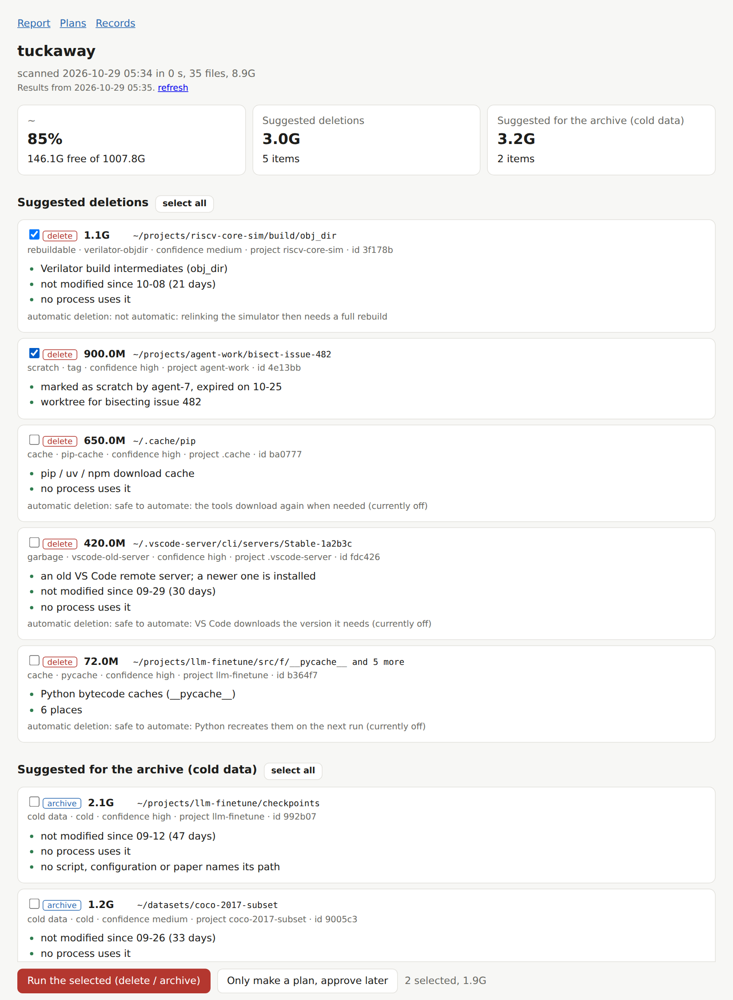

# tuckaway

English | [简体中文](README.zh-CN.md)

[](https://github.com/youzi27/tuckaway/actions/workflows/test.yml)
[](LICENSE)


**Find files nobody uses any more on a shared machine, explain why, and archive or delete them after a person approves.**

It tackles storage bloat in the AI era, when coding agents create builds, runs and scratch files faster than anyone
cleans them up.



## Features

- **One scan, whole picture**: size, last change and daily growth of every big directory.
- **Evidence for every suggestion**: last change, programs run recently, processes using it (cwd, open files,
  libraries, `PATH`), scripts / configs / papers that name its path, symlinks pointing into it, git state, owner tags.
- **Four kinds of suggestions**: delete (garbage, caches, expired scratch), archive (cold data),
  turning cold soon, and big-but-kept (with the reasons).
- **Built-in garbage rules**: `__pycache__`, pip / npm / conda caches, old VS Code servers and extensions,
  temporary directories of finished AI agent sessions, Verilator `obj_dir`, waveforms, core dumps, duplicate
  archives; add your own rules.
- **Owner tags**: `scratch` (with an expiry), `regen` (with the rebuild command), `frozen`, `keep`, `paper`.
- **Nothing happens without approval**: suggestions become a plan; a person approves it in a terminal or in the
  web panel; AI agent shells cannot approve; every path is checked again right before it is touched.
- **Optional automatic deletion**, per rule, with a recommendation and the reason for each rule.
- **Safe archiving**: tar + zstd/gzip, entry count and SHA-256 checked on both sides, stored in a local directory,
  a mounted disk, or over ssh (Linux or Windows); a note is left in place and every move is recorded;
  `tuck restore` brings it back.
- **Web panel**: the report with checkboxes, plans with approve / reject buttons, and the records.
- **Also an agent skill**: [skills/tuckaway](skills/tuckaway/SKILL.md) teaches Claude Code (or any agent that reads
  Agent Skills) to tag what it creates, check before touching others' data, explain suggestions and propose
  plans, but never approve. Or paste the short rules in [docs/agents.md](docs/agents.md) into `CLAUDE.md` / `AGENTS.md`.
- **English or Chinese** interface; Python 3.8+ standard library only; Linux.

## Install

| How | Command | You get |
|---|---|---|
| Claude Code plugin | `/plugin install tuckaway --marketplace youzi27/tuckaway` | the skill and the `tuck` command |
| Agent skill ([skills.sh](https://skills.sh)) | `npx skills add youzi27/tuckaway` | the skill, for Claude Code, Codex, Cursor and more |
| Command line | `pip install --user git+https://github.com/youzi27/tuckaway` | the `tuck` command |

## Quick start

```bash
tuck init      # writes ~/.config/tuckaway/config.toml: what to scan, where archives go, what to keep
tuck scan      # nightly from cron is a good idea
tuck report    # or: tuck serve (web panel)
```

## Commands

| Command | What it does |
|---|---|
| `tuck scan` | scan the configured roots |
| `tuck report` | suggestions and their reasons (`--html`, `--json`) |
| `tuck check <path>` | is anyone still using this path? |
| `tuck tag <dir> --cat ...` | tag a directory (`untag`, `tags`) |
| `tuck plan new --ids ...` | make a plan from suggestions (`plan add`, `plan show`, `plans`) |
| `tuck approve <plan>` | approve a plan (a person, in a terminal) |
| `tuck run <plan>` | run an approved plan |
| `tuck auto` | delete what the rules switched on in `[auto]` found |
| `tuck where <name>` / `tuck restore <path>` | find and bring back archived data |
| `tuck serve` | web panel on 127.0.0.1 |
| `tuck rules` | built-in rules and the automatic-deletion advice |

All settings, with comments: [tuckaway/config_template.toml](tuckaway/config_template.toml).

## License

MIT
