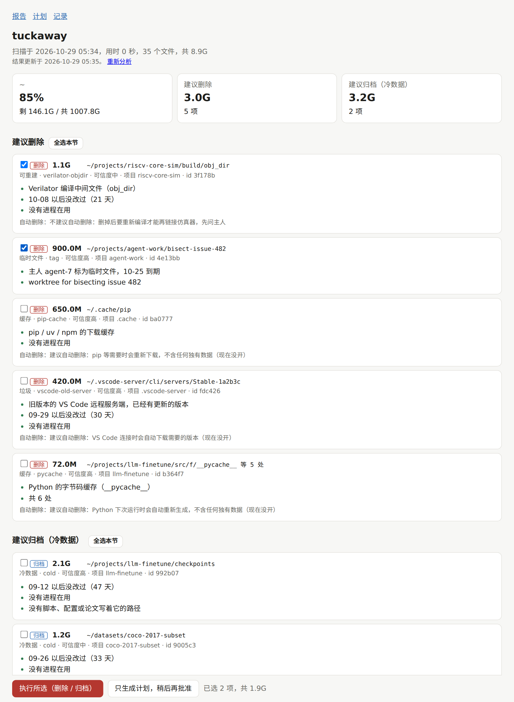

# tuckaway

[English](README.md) | 简体中文

[](https://github.com/youzi27/tuckaway/actions/workflows/test.yml)
[](LICENSE)


**在共用的机器上找出没人用的文件，说清楚为什么，经人批准后归档或删除。**

它解决 AI 时代的存储膨胀问题：AI agent 产生编译目录、实验结果和临时文件的速度，远远快过人去清理。



## 功能

- **扫一遍，看全貌**：每个大目录的大小、最后改动时间、每天涨了多少。
- **每条建议都附证据**：最后改动、里面的程序最近有没有运行、有没有进程在用（工作目录、打开的文件、库、`PATH`）、
  有没有脚本 / 配置 / 论文写着它的路径、有没有链接指向它、git 状态、主人挂的标签。
- **四类建议**：删除（垃圾、缓存、到期的临时文件）、归档（冷数据）、快要变冷的、占地方但不建议动的（附原因）。
- **内置垃圾规则**：`__pycache__`、pip / npm / conda 缓存、旧版 VS Code 服务端和插件、已结束的 AI agent 会话的临时目录、
  Verilator `obj_dir`、波形文件、core dump、重复的压缩包；也可以自己加规则。
- **主人标签**：`scratch`（带到期日）、`regen`（带重建命令）、`frozen`、`keep`、`paper`。
- **不批准什么都不动**：建议先变成计划，由人在终端或网页面板里批准；AI agent 的环境里不能批准；每个路径执行前再查一遍。
- **可选的自动删除**：按规则开启，每条规则都给出建不建议开启和原因。
- **安全归档**：tar + zstd/gzip，两边核对条目数和 SHA-256；存到本地目录、移动硬盘，或用 ssh 传到另一台机器（Linux 或 Windows）；
  原位置留说明，每次转移都有记录；`tuck restore` 一条命令恢复。
- **网页面板**：带勾选框的报告、计划的批准 / 拒绝按钮、记录。
- **也是一个 agent skill**：[skills/tuckaway](skills/tuckaway/SKILL.md) 教 Claude Code（以及支持 Agent Skills 的其他 agent）
  建目录时挂标签、动别人的东西前先检查、解释建议并生成计划，但从不自己批准。也可以把 [docs/agents.md](docs/agents.md)
  里的简短规则贴进 `CLAUDE.md` / `AGENTS.md`。
- **中英文界面**（配置里 `lang = "zh"` 显示中文）；只用 Python 3.8+ 标准库；支持 Linux。

## 安装

| 方式 | 命令 | 装上什么 |
|---|---|---|
| Claude Code 插件 | `/plugin install tuckaway --marketplace youzi27/tuckaway` | skill 和 `tuck` 命令 |
| Agent skill（[skills.sh](https://skills.sh)） | `npx skills add youzi27/tuckaway` | skill，支持 Claude Code、Codex、Cursor 等 |
| 命令行 | `pip install --user git+https://github.com/youzi27/tuckaway` | `tuck` 命令 |

## 快速开始

```bash
tuck init      # 写一份配置 ~/.config/tuckaway/config.toml：扫描哪些目录、归档放哪里、哪些不动
tuck scan      # 建议每晚用 cron 定时跑
tuck report    # 或者：tuck serve（网页面板）
```

## 命令

| 命令 | 作用 |
|---|---|
| `tuck scan` | 扫描配置里的目录 |
| `tuck report` | 建议和理由（`--html`、`--json`） |
| `tuck check <路径>` | 查这个路径还有没有人在用 |
| `tuck tag <目录> --cat ...` | 给目录挂标签（`untag`、`tags`） |
| `tuck plan new --ids ...` | 用建议生成计划（`plan add`、`plan show`、`plans`） |
| `tuck approve <计划号>` | 批准计划（由人在终端里做） |
| `tuck run <计划号>` | 执行已批准的计划 |
| `tuck auto` | 删除 `[auto]` 里开启的规则找到的东西 |
| `tuck where <名字>` / `tuck restore <路径>` | 查找并恢复归档 |
| `tuck serve` | 网页面板（只监听 127.0.0.1） |
| `tuck rules` | 内置规则和自动删除建议 |

全部设置及说明见 [tuckaway/config_template.toml](tuckaway/config_template.toml)。

## 许可证

MIT
